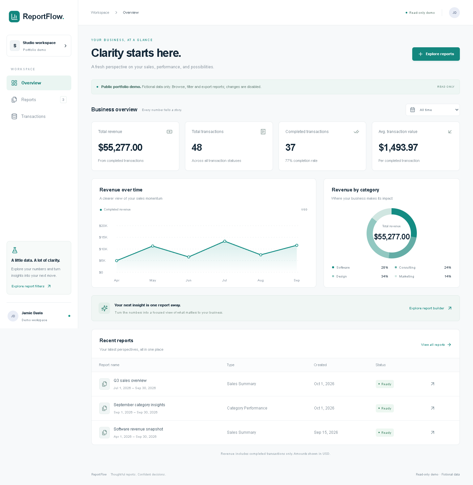

# ReportFlow — Smart Business Report Generation System

A polished sales reporting portfolio project built with Next.js App Router, React, TypeScript, Tailwind CSS, Lucide, Prisma and PostgreSQL. Explore revenue trends, category performance and filterable reports, then download CSV or JSON.



**Two explicit modes:** a public read-only demo with fictional data and no database, and a local PostgreSQL application with persistent CRUD. Authentication and Admin/Viewer roles are **not implemented** and are not required for the read-only demo. Do not publish local mode.

## Live demo

Not deployed yet. A future public demo will use fictional data in server-enforced read-only mode. There is no hosted URL to share at this stage; run it locally using the commands below.

Built by [Sameer37609](https://github.com/Sameer37609). The intended repository name is `reportflow-report-generation`.

## Features

- Responsive analytics dashboard with revenue, transaction count, completion count and average-value KPIs.
- Revenue trend and category charts, search, category/status filters and newest-date transaction sorting.
- Sales Summary and Category Performance reports with inclusive date ranges and optional categories.
- Real CSV/JSON downloads with metadata, exact-money summaries and filtered transaction details. Category Performance includes category totals.
- Public demo: 48 fictional transactions, sample reports, live custom report exploration and exports. No saved changes or writable APIs.
- Local mode: PostgreSQL transaction create/edit/delete, saved report definitions, refresh/restart persistence, validation, loading/error/retry states and delete confirmation.

## Mode and security contract

| Setting         | `demo`                                                                    | `local`                               |
| --------------- | ------------------------------------------------------------------------- | ------------------------------------- |
| Data source     | Fixed fictional records                                                   | Local PostgreSQL `reportflow_dev`     |
| Database access | Prohibited by application guard                                           | Allowed after local-target validation |
| Writes          | Server proxy rejects POST/PUT/PATCH/DELETE, including arbitrary API paths | Validated CRUD on loopback            |
| Saved reports   | Fixed examples; custom previews are unsaved                               | Persisted definitions                 |
| Exports         | Fictional data only                                                       | Database-derived data                 |
| Auth/roles      | None, no write capability                                                 | None; development only                |

`REPORTFLOW_MODE` has no fallback. Missing/invalid values fail configuration checks; request handling also fails closed. Vercel hosting rejects `local` mode. A database access guard and separate read source prevent demo requests from querying PostgreSQL even if a connection URL is accidentally present. Pages resolve mode per request rather than embedding local/demo state into static HTML. The browser receives only the mode label, never database credentials.

## Requirements

Node.js 22.18+ and npm. PostgreSQL is needed **only for local mode**. Verified versions: Next.js 16.4.5, React 19.3.1, Prisma 6.19.3, PostgreSQL 18. Use `npm ci` and the included lockfile for reproducible versions. Webpack is intentional for the Windows compiler fallback.

## Run the public demo without PostgreSQL

```powershell
npm ci
npm run demo:dev
```

Open http://127.0.0.1:3000. These explicit demo scripts set `REPORTFLOW_MODE=demo` and mask `DATABASE_URL` before Next loads local environment files.

To verify the optimized demo:

```powershell
npm run demo:build
npm run demo:start
```

Demo setup does not need `.env`, PostgreSQL, migration commands, authentication secrets or paid services. Prisma client generation during installation does not connect to a database and has been verified with an empty DATABASE_URL.

## Local PostgreSQL setup

Credentials belong only in Git-ignored `.env`. Required names:

- `REPORTFLOW_MODE=local`
- `DATABASE_URL` — a PostgreSQL connection URL for localhost and `reportflow_dev`; keep its value private.

`.env.example` contains placeholders. Do not put secrets in NEXT_PUBLIC variables. The setup helper prompts privately and never prints the password or URL:

```powershell
.\scripts\configure-local-db.ps1
```

Create the database first if it does not exist. With PostgreSQL's command-line tools on PATH, connect with your administrator account:

```powershell
psql -h localhost -p 5432 -U postgres -d postgres -W
```

At the SQL prompt:

```sql
CREATE ROLE reportflow_user LOGIN CREATEDB;
\password reportflow_user
CREATE DATABASE reportflow_dev OWNER reportflow_user;
\q
```

Enter passwords only at local prompts. Substitute your administrator username/install path if different. Do not repeat CREATE statements for existing objects. CREATEDB is for Prisma's development shadow database, not a production role.

```powershell
npm ci
npm run db:generate
npm run db:migrate
npm run dev
```

Open http://127.0.0.1:3000. For a local production-mode check, use `npm run build` then `npm start`; `.env` must explicitly select local mode. Normal dev/start scripts bind to loopback. No local authentication is provided.

On the Codex runtime where npm is not on PATH, already-installed packages can be run directly:

```powershell
node scripts/demo.mjs dev --webpack --hostname 127.0.0.1
# Or, using the private .env with REPORTFLOW_MODE=local:
node scripts/next.mjs dev --webpack --hostname 127.0.0.1
```

Stop servers before building or regenerating Prisma on Windows. OneDrive may leave stale generated `.next` entries; only that generated folder should be cleared if necessary. The WASM fallback uses an internal Next setting; recheck it when upgrading Next.

## Database and calculations

`Transaction` stores an internal ID, unique business transaction ID, customer, category, DECIMAL(12,2) amount, calendar date, status and timestamps. `SavedReport` stores title, type, date range, optional category and timestamps. Reports reflect current records rather than frozen historical snapshots.

Revenue counts Completed transactions only. Average value divides completed revenue by completed count; total count includes all statuses. Server/export calculations use Prisma Decimal; chart calculations sum integer cents. JSON exports preserve exact money as decimal strings, with USD explicitly identified. Frontend data loading is intentionally simple and portfolio-scale rather than paginated for very large databases.

## REST APIs and exports

JSON API responses use `{data: ...}` / `{error: "..."}`; DELETE returns 204. Invalid input returns 400, denied demo writes/origins return 403, missing records return 404, duplicate transaction IDs return 409 and unavailable data returns 503. Local updates use PUT, not PATCH.

| Endpoint                                               | Methods               | Purpose                                     |
| ------------------------------------------------------ | --------------------- | ------------------------------------------- |
| `/api/transactions`                                    | GET, local POST       | Read transactions / create locally          |
| `/api/transactions/:id`                                | GET, local PUT/DELETE | Read/edit/delete a local transaction        |
| `/api/reports`                                         | GET, local POST       | List definitions / save locally             |
| `/api/reports/:id`                                     | GET, local DELETE     | Filtered rows, definition and exact metrics |
| `/api/analytics`                                       | GET                   | Overall KPI totals                          |
| `/api/reports/:id/export?format=csv` or `json`         | GET                   | Download using the saved report's filters   |
| `/api/reports/preview?...`                             | GET                   | Unsaved validated live report               |
| `/api/reports/preview/export?...&format=csv` or `json` | GET                   | Download an unsaved filtered report         |

Preview query fields: `title`, `type`, `start`, `end`, optional `category`. Types: Sales Summary or Category Performance. Dates use YYYY-MM-DD. Categories: Software, Consulting, Design, Marketing. Duplicate/unknown query keys, invalid types/dates/categories and reversed ranges are rejected. Saved exports reject attempts to override saved filters; use preview exports for custom filters.

CSV is UTF-8 with BOM, CRLF rows and quoted/escaped fields. Formula-like text starting with =, +, -, @ after whitespace, or leading tab/CR/LF, is prefixed with an apostrophe. CSV preserves spreadsheet safety; JSON retains the original text. Filenames are sanitized, responses use attachment headers and correct content types, and downloads are not cached. Valid empty reports download metadata, zero totals and column headers. Errors show inline without navigating away from the report.

## Architecture

- `lib/mode.ts`, `proxy.ts`, `next.config.ts`: explicit mode, fail-closed configuration and demo write enforcement.
- `lib/source.ts`: chooses fictional reads or dynamically loads the local database path.
- `lib/db.ts`: guarded, reused Prisma client.
- `lib/api.ts`: input validation, safe errors and local Origin checks.
- `lib/exports.ts`, `lib/report-export.ts`: exact summaries, CSV safety, export responses and preview validation.
- `components/`: shared shell, cards/charts, transaction editor and download controls.

No auth framework, extra backend service or new chart/export library was added.

## Optional fictional seed — local only

```powershell
node --env-file=.env --experimental-strip-types prisma/seed.mts
```

This requires explicit local mode and empty local tables. It atomically adds 48 fictional transactions and three reports and never resets existing data. It was not run during these fixes.

## Tests

```powershell
npm run lint
npm run typecheck
npm test
npm run test:config
npm audit
npm audit --omit=dev
npm run demo:build
```

To run public API regressions, start the built demo on port 3004:

```powershell
node scripts/demo.mjs start --hostname 127.0.0.1 --port 3004
node tests/demo-api.mjs
```

For scoped local database regressions, serve local mode on port 3005, then run in another terminal:

```powershell
$env:TEST_BASE_URL='http://127.0.0.1:3005'
node tests/audit-api.mjs
node tests/local-exports.mjs
# Stop and restart the local server before cleanup/persistence verification:
node tests/audit-cleanup.mjs
```

These tests keep exact fixture IDs in ignored test-results, refuse an outstanding audit marker and compare before/after existing-data fingerprints. Do not edit records concurrently or rerun before cleanup. Local APIs intentionally have no auth: the old audit's security-failure message describes **local mode**, not the read-only public demo.

Manual checklist: download CSV/JSON from both report types; explore category/date filters and empty periods; inspect values in a spreadsheet/text editor; verify demo mutation controls are absent; test mobile navigation and keyboard focus; in local mode add/edit/delete a transaction and revisit a report after restart. Automated test outcomes and limitations are recorded in [the latest verification report](docs/PUBLIC-DEMO-VERIFICATION.md).

## Dependency security

Patch updates: Next.js/SWC/lint config 16.4.5 and Prisma/client 6.19.3. Prisma CLI is a development dependency. Two scoped overrides remediate dependencies still pinned by upstream tooling: `@prisma/config → deepmerge-ts 8.0.0` and `@typescript-eslint/typescript-estree → minimatch 11.0.1`.

These are targeted transitive-major overrides, not `npm audit fix --force`. The used merge/glob APIs and Node requirements were reviewed; consumer-API tests, Prisma generation/validation/migration checks, lint, build and database regressions verify this project's usage. Review/remove overrides when upstream supports patched versions, and rerun all checks when updating. Current full and runtime advisory scans report **zero advisories**; this is a dated result, not a permanent security guarantee.

## GitHub and hosting readiness

Source, migrations, tests, fictional data, docs, screenshot and placeholder `.env.example` are intended for publication review. Real credentials, backups, local records, dependencies, builds and test artifacts are ignored. Ignore rules do not protect against forced staging; inspect staged files before publication. GitHub publication and hosted deployment require separate approval.

The read-only demo is prepared for a future Next.js Node-runtime host such as Vercel. Set **REPORTFLOW_MODE=demo** in both build and runtime environments, omit DATABASE_URL, install development/build dependencies so Prisma generation can run, and use `npm run demo:build` (or standard build with explicit demo mode). No production database, migrations, auth secrets or paid services are required. Vercel supplies its own runtime; the local `demo:start` command is for previewing locally.

Hosted behavior is **not tested**, because deployment remains prohibited. Review provider configuration and run hosted smoke/security/download checks after approval. Never configure hosted local mode or remove the guards to make local data reachable. A future authenticated writable system is a separate phase requiring server-side permissions and sessions.

Known limitations: no authentication/roles, no concurrent-edit detection, no large-data pagination, reports are not historical snapshots, and no full assistive-technology/WCAG audit. Accessibility basics and browser checks are verified, not a claim of complete accessibility compliance.
